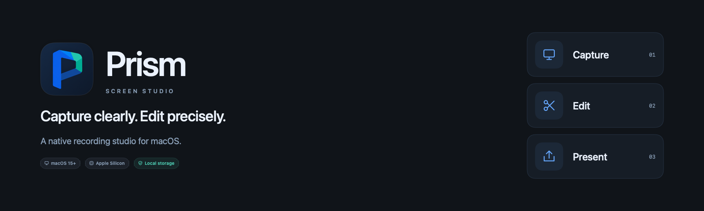
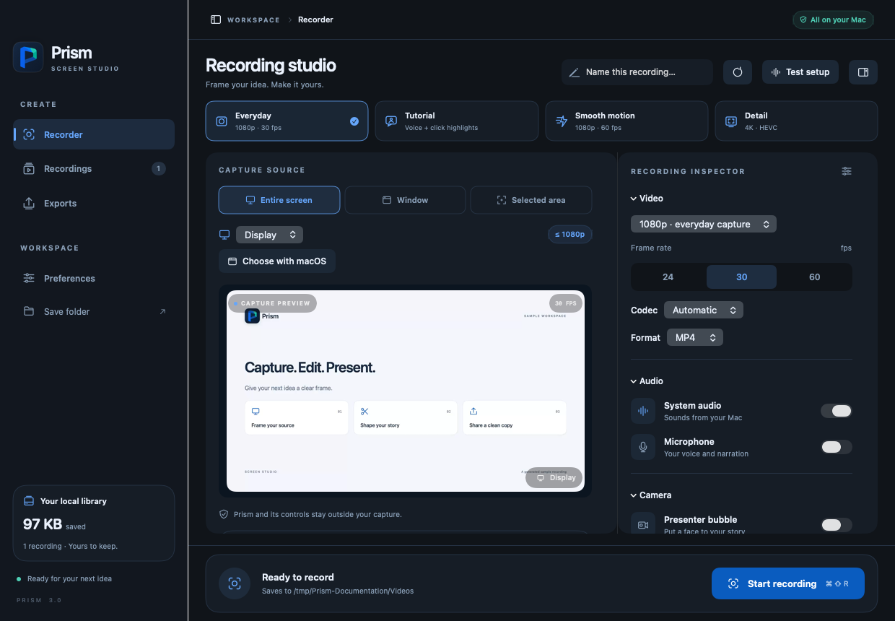
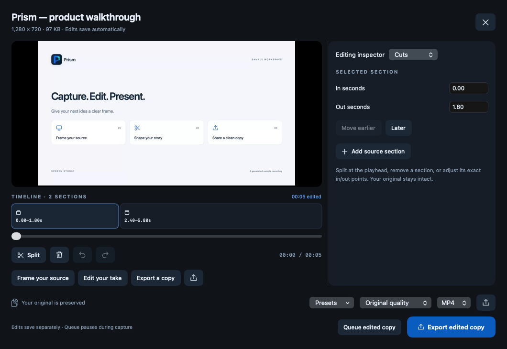
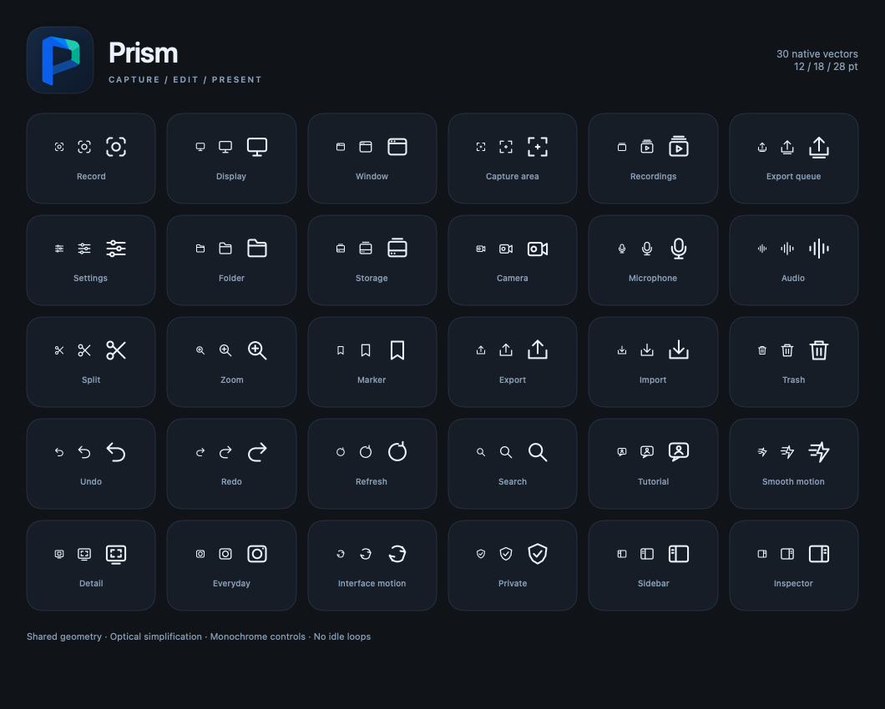

<div align="center">
  <picture>
    <source media="(prefers-color-scheme: dark)" srcset="docs/media/hero-dark.png">
    <source media="(prefers-color-scheme: light)" srcset="docs/media/hero-light.png">
    
  </picture>

  <p><strong>A focused studio for recording, editing, and presenting your screen.</strong></p>
  <p>macOS 15+ &nbsp; · &nbsp; Apple Silicon &nbsp; · &nbsp; SwiftUI &nbsp; · &nbsp; Local storage</p>
  <p>
    <a href="https://github.com/joinsafayet/screen-recorder/releases/download/v3.0.1/Prism-macOS.zip"><strong>Download Prism 3.0.1</strong></a>
    &nbsp; / &nbsp;
    <a href="docs/USER_GUIDE.md">User guide</a>
    &nbsp; / &nbsp;
    <a href="CHANGELOG.md">What’s new</a>
    &nbsp; / &nbsp;
    <a href="https://github.com/joinsafayet/screen-recorder/actions/workflows/macos.yml">Build & tests</a>
  </p>
</div>

---

## A clear frame for your next idea

Prism records displays, windows, and precise areas, then helps you shape the take with a saved timeline. Capture narration and a presenter bubble, add captions and annotations, and export a polished copy while preserving the original.

<picture>
  <source media="(prefers-color-scheme: dark)" srcset="docs/media/studio-dark.png">
  <source media="(prefers-color-scheme: light)" srcset="docs/media/studio-light.png">
  
</picture>

<sub>Interface previews use Prism’s actual views and a generated sample recording. The editor preview includes a decoded sample still.</sub>

## Capture → Edit → Present

| Capture with control | Shape the take | Keep work organized |
| --- | --- | --- |
| Native macOS source picker | Split, remove, and reorder sections | Projects, tags, and search |
| Movable, resizable, saved areas | Crop, aspect ratios, and zoom keyframes | Favorites and batch actions |
| System audio and microphone | Audio levels and fades | Persistent export queue |
| Presenter bubble and setup meters | Arrows, drawings, and timed text | Saved export presets |
| Countdown, pause, markers, and test takes | Manual/on-device captions and SRT | Original-file protection |
| H.264/HEVC, MP4/MOV, up to 4K/60 | Undo/redo and automatic edit saving | Interrupted-fragment recovery |

### A timeline that preserves the source



Edits live in separate documents. The export queue saves a snapshot of each edit, processes one job at a time, and yields to capture. Cancellation leaves the existing destination intact.

### An interface with its own identity

The folded P mark combines a capture aperture with a refracted edge. Cobalt, sea green, and navy anchor the brand; dark, light, and system appearances support four selectable UI accents. Thirty native vector glyphs share one optical grid, with simpler geometry for tiny controls. Motion stays short, interruptible, and Reduce Motion aware.

<details>
<summary><strong>Explore the icon family and brand assets</strong></summary>



[Brand guide and palette](Assets/Brand/README.md) · [Download brand kit](https://github.com/joinsafayet/screen-recorder/releases/download/v3.0.1/Prism-Brand-Kit.zip)

</details>

## Get started

1. Download the [macOS app archive](https://github.com/joinsafayet/screen-recorder/releases/download/v3.0.1/Prism-macOS.zip), unzip it, and move **Prism.app** into Applications.
2. Open Prism and choose a source with **Choose with macOS**, or use **Set up recording** for screen access.
3. Enable your microphone/camera if needed, use **Test setup**, then make a **5-second test take**.
4. Record, open the take in the library, and export an edited copy.

This is an **Apple Silicon development preview**, locally signed and not notarized. Microphone/camera and automatic captions require the relevant permissions and devices. No account is required for recording. Downloads from this private repository require repository access.

[Setup, shortcuts, storage, and permission details →](docs/USER_GUIDE.md)

## Built for sustained recording

ScreenCaptureKit feeds a bounded media queue. Encoding requests hardware acceleration, previews/meters are throttled, and media/file work runs away from the UI. Recovery journals and ten-second movie fragments help restore completed media after interruption.

The local verification suite passes **26 functional/media checks**. A 60-second paced synthetic 4K60 test with presenter composition and dual audio saved **3,600/3,600 source frames with zero video/audio drops**. This measures encoder/compositor throughput; actual source, devices, disks, and workload affect performance. Unlocked live UI/capture and physical-device checks remain documented separately.

[Verification evidence and limits →](docs/VERIFICATION.md)

## Build from source

Apple’s command-line developer tools with a macOS 15+ SDK are sufficient. No third-party package dependencies are required.

```sh
git clone https://github.com/joinsafayet/screen-recorder.git
cd screen-recorder
scripts/build.sh
scripts/verify.sh
```

Outputs: `build/Prism.app`, `build/Prism-macOS.zip`, and `build/SHA256SUMS.txt`. GitHub Actions also builds the app and runs the media checks on macOS. Permission-dependent capture tests run locally on an unlocked Mac.

[Contributing and deeper checks →](CONTRIBUTING.md)

## Project map

| Location | Purpose |
| --- | --- |
| [`Sources/Prism`](Sources/Prism) | Capture engine, studio, timeline, library, and native UI |
| [`Tests`](Tests) | Generated-media checks and isolated interface preview host |
| [`Assets/Brand`](Assets/Brand) | Logo masters, colors, and artwork prompts |
| [`scripts`](scripts) | Build, packaging, icon pipeline, and verification |
| [`docs`](docs) | User guide, roadmap, verification, and interface media |

[Release notes](CHANGELOG.md) · [Roadmap](docs/ROADMAP.md) · [Report a bug](https://github.com/joinsafayet/screen-recorder/issues/new/choose) · [Request a feature](https://github.com/joinsafayet/screen-recorder/issues/new/choose)
